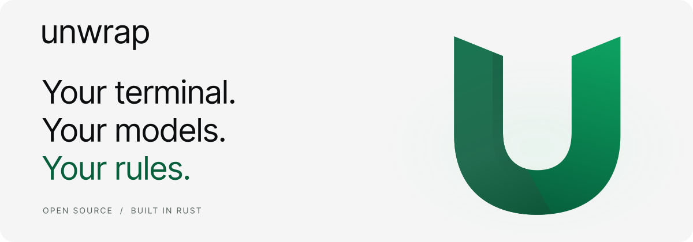

<p align="center">
  <picture>
    <source media="(prefers-color-scheme: dark)" srcset="assets/readme/hero-dark.svg">
    <source media="(prefers-color-scheme: light)" srcset="assets/readme/hero-light.svg">
    
  </picture>
</p>

<p align="center">
  <strong>An open-source terminal with built-in AI, powered by your own keys.</strong><br>
  Built in Rust. GPU-accelerated. No account required.
</p>

<p align="center">
  <a href="#quickstart"><strong>Get started</strong></a> &nbsp;·&nbsp;
  <a href="#key-features">Features</a> &nbsp;·&nbsp;
  <a href="#configuring-ai-models">AI setup</a> &nbsp;·&nbsp;
  <a href="#development">Development</a> &nbsp;·&nbsp;
  <a href="FAQ.md">FAQ</a>
</p>

## About

**Unwrap** brings your shell, coding agent, and everyday development workflow into one native
terminal. Work in a desktop window with tabs and split panes, or use the console interface inside
your existing terminal.

No sign-in, telemetry, or cloud session sync. When you use AI, Unwrap connects directly from your
machine to the provider or local endpoint you choose. Your prompts and selected context are sent
to that endpoint; your API keys are stored on your device.

Unwrap builds on the open-source [Warp](https://github.com/warpdotdev/warp) codebase.

## Key features

<table>
  <tr>
    <td width="50%" valign="top">
      <h3>A native terminal</h3>
      <p>GPU-accelerated rendering, tabs, split panes, and block-based command output, built on the Rust-powered WarpUI framework.</p>
    </td>
    <td width="50%" valign="top">
      <h3>Your choice of AI</h3>
      <p>Bring keys for Anthropic, OpenAI, Google Gemini, or OpenRouter. Connect a compatible local model server through a custom endpoint.</p>
    </td>
  </tr>
  <tr>
    <td valign="top">
      <h3>An agent that can act</h3>
      <p>Ask the built-in coding agent to inspect files, run shell commands, and apply patches without leaving your terminal.</p>
    </td>
    <td valign="top">
      <h3>Everyday shell comforts</h3>
      <p>Command completions, syntax highlighting, searchable history, and configurable keyboard shortcuts keep familiar work close at hand.</p>
    </td>
  </tr>
</table>

## Quickstart

### Prepare your machine

Install [Rust via rustup](https://rustup.rs/). The repository pins its toolchain in
[`rust-toolchain.toml`](rust-toolchain.toml), so rustup can select the correct version automatically.

| Platform | Build requirements |
| --- | --- |
| **macOS** | Full Xcode installation and Homebrew. Command Line Tools alone are insufficient for the bootstrap script. |
| **Linux** | The bootstrap script uses `apt` to install native build and test dependencies. See the [Linux setup script](script/linux/bootstrap). |

Clone your copy of this repository using its **Code** menu, then run these commands from the
repository root:

```bash
./script/bootstrap --skip-common-skills --skip-gcloud-auth
```

This installs the platform development tools while skipping optional shared agent skills and the
Google Cloud sign-in used for SSH integration tests.

### Launch Unwrap

**Desktop app**

```bash
WARP_SKIP_COMMON_SKILLS_INSTALL=1 ./script/run
```

The run script builds and launches the OSS app when the internal `warp-channel-config` tool is
absent. On macOS, this opens **Unwrap.app**.

**Console interface**

```bash
./script/run-tui
```

The TUI runs inside your current terminal and shares the application's core and agent functionality.

## Configuring AI models

1. Open **Settings** (<kbd>⌘</kbd> + <kbd>,</kbd> on macOS).
2. Under **Agents → Agent**, find the provider API key fields.
3. Add the key for your preferred provider, then select a corresponding model in the agent's
   model picker.

| Provider | How to connect |
| --- | --- |
| **Anthropic** | Add an Anthropic API key and select a Claude model. |
| **OpenAI** | Add an OpenAI API key and select an OpenAI model. |
| **Google Gemini** | Add a Google API key and select a Gemini model. |
| **OpenRouter** | Add an OpenRouter API key and select a model available through OpenRouter. |
| **Local or custom server** | Add a custom endpoint with its base URL, API key, protocol, and model identifier. |

### Use a local model

In the same settings page, add a **Custom endpoint** for a server such as Ollama, LM Studio, vLLM,
or LiteLLM. Custom endpoints support OpenAI Chat Completions, OpenAI Responses, or Anthropic
Messages; choose the protocol your server exposes.

For example, a default Ollama server uses `http://localhost:11434/v1` with **OpenAI Chat
Completions**. Enter the exact identifier of a model installed on your server. The current client
requires a non-empty API key field; for a local server that does not require authentication, use a
placeholder such as `ollama`.

Choose a model with tool-calling support to use the agent's file and shell tools.

## Bundling

Build an unsigned macOS app and DMG for the current architecture:

```bash
./script/macos/bundle --channel oss --nouniversal --nosign
```

The app is named **Unwrap.app**. The bundle script reports its output paths; builds are placed
under the architecture-specific Cargo target directory.

For versioned release builds and the GitHub setup checklist, see
[Unwrap CI and releases](.github/workflows/README.md). Release downloads will be published
on [Unwrap Releases](https://github.com/vaaibhavmishra/unwrap/releases).

## Development

### Architecture

Unwrap is a Cargo workspace with a shared core and two front-ends:

| Area | What lives here |
| --- | --- |
| [`app/`](app) | Desktop application, terminal views, AI integration, settings, and workspaces |
| [`crates/warp_tui/`](crates/warp_tui) | Console front-end |
| [`crates/warpui/`](crates/warpui) | Native UI framework and platform rendering |
| [`crates/warpui_core/`](crates/warpui_core) | Shared UI primitives, layout, events, and TUI elements |
| [`crates/warp_terminal/`](crates/warp_terminal) | Terminal emulation and grid storage |
| [`crates/editor/`](crates/editor) | Text editing and syntax highlighting |
| [`crates/warp_core/`](crates/warp_core) | Shared utilities and platform abstractions |
| [`script/`](script) | Setup, build, packaging, and development tools |

Internal crate names and the `warp-oss` binary name are retained from upstream.

### Tests and code quality

Run checks for the package you changed. For example, for `warp_terminal`:

```bash
cargo nextest run -p warp_terminal
cargo clippy -p warp_terminal --all-targets --tests -- -D warnings
./script/format
```

For wider changes, run `cargo nextest run --no-fail-fast --workspace`. See
[`AGENTS.md`](AGENTS.md) for the complete validation order and front-end-specific guidance.

### Contribute

Bug fixes, documentation improvements, and thoughtful new features are welcome. Start with the
[contribution guide](CONTRIBUTING.md) and [code of conduct](CODE_OF_CONDUCT.md). For security
reports, follow the [security policy](SECURITY.md).

The [brand guide](assets/branding/BRAND.md) and [asset inventory](assets/branding/INVENTORY.md)
include the Unwrap logos, application icons, and light and dark variants used in this project.

## Licensing

| Component | License |
| --- | --- |
| WarpUI — `crates/warpui` and `crates/warpui_core` | [MIT](LICENSE-MIT) |
| Terminal application and remaining crates | [GNU AGPL v3](LICENSE-AGPL) |

<p align="center">
  <picture>
    <source media="(prefers-color-scheme: dark)" srcset="assets/branding/unwrap-symbol.svg">
    
  </picture>
  <br>
  <sub>Your terminal. Your models. Your rules.</sub>
</p>
