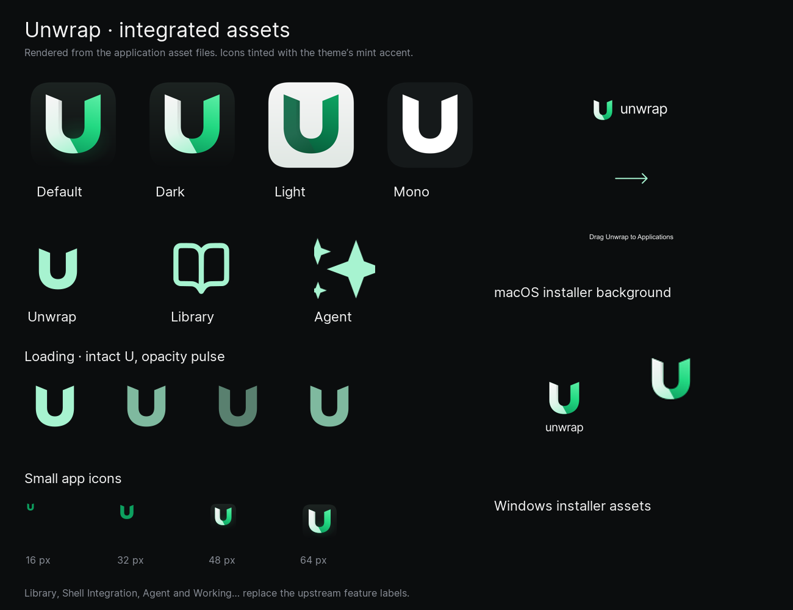

# Unwrap application rebrand

Implemented in the working tree on October 30, 2026. This report updates the
[original audit](proposals/rebrand-audit.md), which records what was present before implementation.
The source and asset changes are in place. A rebuilt application has not been verified because
the separate authentication/cloud cleanup in this checkout currently prevents compilation.

## Names and symbols

| Original | Now | Symbol or behavior |
| --- | --- | --- |
| Warp | Unwrap | Existing emerald-and-pearl U; solid silhouette in compact controls |
| Warp Drive | Library | Open book |
| Warpify | Shell Integration | Terminal prompt |
| Warpify SSH Sessions | SSH Integration | Enable/disable SSH integration |
| Warp AI / Warp Agent | Agent | Sparkle |
| Warping… | Working… | Intact U with a gentle opacity pulse |
| Warp Agent CLI | Unwrap CLI | Upright terminal-cell U |
| Warp mode | Pinned | Pinned/Classic input-mode labels |
| Open in Warp | Open in Unwrap | Existing open action |

Updated settings navigation and descriptions, Command Palette actions, context menus, tooltips,
onboarding, local model/MCP labels, status text and CLI headings. Settings accepts both new labels
and legacy page names; stored slugs and settings keys keep their existing values.

## Asset inventory and replacements

The [application asset manifest](app-integration.json) lists **103 unique generated app files**:

| Area | Files | Replacement |
| --- | ---: | --- |
| Shared symbols and font-generation source | 6 | U for app identity, open book for Library, sparkle for Agent |
| Loading SVG sequence | 12 | Same intact U in every frame, opacity from 0.5 to 1.0 |
| Dock artwork | 22 | All 20 historical resources replaced; new Dark and Light resources added |
| Channel icon resources | 55 | PNG/ICO artwork for OSS, stable, preview, dev and local; U-based Icon Composer sources |
| Installer artwork | 3 | macOS drag-to-Applications background and both Windows BMPs |
| Onboarding artwork | 5 | Four Library illustrations and the launch banner |

The earlier [14 base mappings](integration.json) also remain integrated: the OSS ICNS/ICO/PNG
icons and shared symbol/wordmark SVGs. These mappings overlap the newer manifest and should not
be added to its file count. Historical asset filenames are retained for existing callers.

Dock choices are **Default, Dark, Light and Mono**. Legacy preferences deserialize to the new
choices, and the Dock plugin also recognizes older saved names. They cannot restore old Warp
artwork from the replaced resources.

The GUI loading component renders the SVG directly, replacing the private-use U+E500 font glyph.
It uses a two-second opacity pulse without rotation or separated arms. On macOS, Reduce Motion
uses a static symbol and text. Other desktop platforms retain the pulse. The TUI's built-in mark
stays upright and does not respond to drag rotation; custom ASCII objects retain rotation and
drag behavior. Its background starfield remains animated.

The four onboarding images are reproducible Library illustrations, not screenshots of a running
application. Their original dimensions and reference paths are preserved.



This sheet uses the actual application artwork. Loading samples are static phases, and feature
icons are shown with a representative mint tint; the app uses the selected theme's tint.

## Retained upstream references

Rust identifiers, binary names, bundle IDs, URL schemes, shell protocols, filesystem paths,
telemetry keys and stored settings remain compatible. Non-OSS packaging names still follow their
existing channel scripts even though their artwork is replaced.

Names for genuine Warp/Oz cloud services, accounts, billing, published benchmarks, documentation,
plugin downloads and upstream attribution are retained. Third-party logos and upstream cloud
promotion artwork remain. Renaming those would misrepresent their destination or provenance.
Some legacy cloud and launch code is being removed in the separate cleanup; its final reachability
has not been checked in a running Unwrap build.

## Verification

- Master brand validator passed: 37 PNGs, 27 SVGs, ICNS, ICO and all 14 base application mappings.
- App validator passed: 103 unique output paths, expected raster sizes, Dock transparency,
  ICO representations, SVG parsing/geometry and all 12 loading-frame opacities.
- The integrated contact sheet was visually inspected, including small icons and light/dark variants.
- Onboarding: **38/38 tests passed** with `cargo nextest run -p onboarding --lib --offline`.
- Isolated projection harness: **24/24 checks passed**, including 23 tests extracted from the TUI
  source and a rendered-frame inspection. It compiled the actual geometry/projector functions
  with small configuration/size wrappers; it does not replace the full TUI integration suite.
- Isolated settings checks passed: new/legacy page navigation and display labels, plus both Dock
  preference migration/round-trip tests. These use extracted definitions and the actual Dock tests.
- The actual GUI loading module compiled in isolation against cached matching dependencies.
- Dock plugin Objective-C syntax check and integration-script JavaScript syntax check passed.
- Targeted `cargo clippy -p warp_core --lib --offline -- -D warnings` passed.
- Rebrand-touched surviving Rust files and the Dock plugin were formatted after validation.

The full GUI check and app/TUI tests remain blocked by the concurrent cleanup. The latest check
failed in `crates/warp_cli/src/integration.rs` because `crate::provider` had been removed. Earlier
attempts also encountered missing authentication/IAP and Workspace APIs. Two rebrand-specific
settings-title type errors found during review were corrected to use `PageTitle::new`.

The combined CLI/onboarding test attempt had 54 passes and one unrelated CLI parser failure for
a removed `api-key` command. Combined Clippy was blocked by an orphan documentation comment in
the concurrently edited CLI. Native Icon Composer export failed for both original and replacement
sources on this host; ordinary OSS ICNS/ICO decoding passed.

Live GUI/TUI rendering, reduced-motion behavior in a running app, the final Dock, and native
non-OSS layered icon exports remain unverified. No full presubmit was run.

## Regeneration

From the repository root, with Node plus `sharp`/`@napi-rs/canvas` and Python plus Pillow:

```sh
node assets/branding/scripts/generate.cjs --integrate
node assets/branding/scripts/integrate-app.cjs
python3 assets/branding/scripts/validate.py
python3 assets/branding/scripts/validate-app.py
```

The first generator produces the master kit and base mappings; the second refreshes the broader
application assets. Neither rewrites Rust names or compatibility identifiers.
