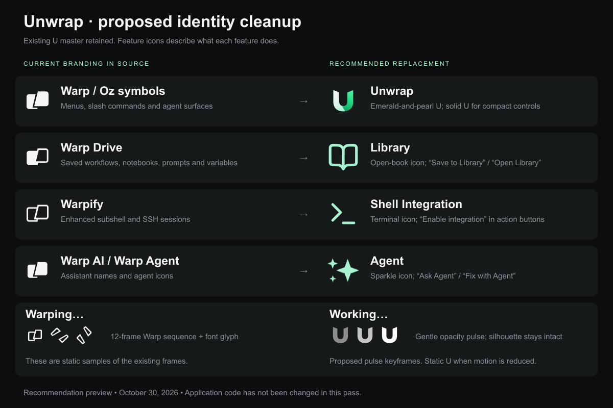

# Unwrap branding audit and recommendations

**Historical audit:** the approved recommendations have now been implemented in source and
assets. See [implementation status and verification](../REBRAND-STATUS.md) for the current result.
The inventory below describes the state before implementation.

Inspected October 30, 2026. This is a source and asset audit of the current working tree, including
its existing local changes. Visibility can depend on platform, feature flags, and build channel;
this report does not claim every retained asset appears in the running OSS application.

## Recommended names and symbols

| Existing name or surface | Recommendation | Symbol / example copy |
| --- | --- | --- |
| Warp application branding | **Unwrap** | Existing emerald-and-pearl U. Lowercase `unwrap` only in the existing wordmark artwork. |
| Warp Drive | **Library** | Open book. “Open Library”, “Save to Library”, “Search Library”. Use **Unwrap Library** when describing it outside the app. |
| Warpify settings | **Shell Integration** | Terminal prompt icon. Describes the subshell and SSH integration this page configures. |
| Warpify subshell | **Enable integration** | “Enable shell integration” where the button needs to stand alone. |
| Warpify SSH Sessions / SSH Warpification | **SSH Integration** | “Enable SSH integration” / “Disable SSH integration”. |
| Warp AI / Warp Agent / local Oz assistant wording | **Agent** | Sparkle icon. “Ask Agent”, “Fix with Agent”; **Unwrap Agent** in external documentation. |
| Warping… | **Working…** | An intact, gently pulsing U. Preserve specific states such as “Thinking”, “Running”, or “Waiting” where already available. |
| Warp Agent CLI | **Unwrap CLI** | Small U, including an appropriate terminal-cell version in the TUI. |
| Warp mode (input position) | **Pinned** | “Pin to the bottom”; retain the existing Classic label for the other position. |
| Welcome to Warp / Open in Warp | **Welcome to Unwrap / Open in Unwrap** | Existing U or an ordinary open action icon, according to context. |

Library fits the actual feature: the current settings page describes saved workflows, notebooks,
prompts, and environment variables stored locally. The name avoids suggesting a remote drive.
Shell Integration communicates the behavior without requiring a new coined verb such as
“Unwrapify”. Agent keeps the same name across settings, actions, status messages, and the TUI.

Oz cloud services, account pages, billing plans, and upstream announcements need a visibility and
destination check. A service that still opens Warp's infrastructure must retain an accurate
service name, or be removed from the Unwrap interface if unavailable. Relabeling it does not make
it an Unwrap service.

The preview pairs representative retained glyphs with proposed feature names. It is an illustrated
recommendation, not a screenshot of current controls. The loading samples are static keyframes.

## Already integrated

All **14 mappings** in `assets/branding/integration.json` were checked byte-for-byte and match
their source exports:

- OSS macOS ICNS, Windows ICO, and seven Linux PNG sizes.
- Three standalone symbol variants under the historical `warp-logo-light.svg`,
  `warp-logo-dark.svg`, and `warp-logo-neutral.svg` paths.
- Two horizontal wordmarks under the historical `warp-logo-with-*-title.svg` paths.

The current README, OSS bundle metadata, and Linux launcher use Unwrap. About, authentication,
and get-started code reference the replaced SVGs, although some accompanying copy still says Warp.

## Branding still present

| Area | Current evidence | Proposed treatment |
| --- | --- | --- |
| Small app / feature symbols | `app/assets/bundled/svg/warp.svg`, `warp-2.svg`, `warp-3.svg`, `warp-drive.svg` all retain the offset Warp shapes. | U for app identity; open book for Library; sparkle for Agent; terminal for Shell Integration. |
| SVG loading sequence | **12 files**, `app/assets/bundled/svg/warp-loading-0.svg` through `warp-loading-11.svg`; mapped by `Icon::Warping0` through `Icon::Warping11`. | Intact U pulse if these frames are used, with no arm separation or rotation. |
| Shimmering loading indicator | `app/src/ai/loading/shimmering_warp_loading_text.rs:11` and `app/src/ai/blocklist/block/view_impl/common.rs:597` use the private-use font glyph `U+E500`. Callers include terminal and ambient-agent loading views. | Replace the glyph-based brand rendering with the Unwrap symbol; changing SVGs alone does not cover this. |
| Font generation source | `script/patch_font_with_warp_glyph` defaults to `script/warp.svg`, glyph name `warpLogo`, codepoint `0xE500`. | Update or retire the logo injection path when replacing the loading glyph. |
| AI progress copy | `app/src/ai/blocklist/block/view_impl/common.rs:115` says “Warping...”; `status_bar.rs:1150` has the fallback “Warping with another model.” | “Working…” and matching model-aware wording. |
| TUI welcome identity | `crates/warp_tui/src/zero_state_animation.rs:79` onwards contains hardcoded old-logo bounds and face polygons. `zero_state.rs:652` says “Warp Agent CLI”. | Derive an upright cell-grid U from the existing master; use a quiet pulse. Change heading to Unwrap CLI. |
| TUI progress label | `crates/warp_tui/src/terminal_session_view.rs:5540` says “Warping”. | “Working”; the ordinary dot spinner can remain. |
| Feature navigation and labels | `app/src/settings_view/mod.rs:352`, `:394`; `warp_drive_page.rs:164`; `warpify_page.rs:517`; `app/src/workspace/view/left_panel.rs:583`. | Library, Shell Integration, Agent; also update descriptions, search terms, buttons, tooltips, and Command Palette entries. |
| App copy and context menus | `app/src/pane_group/pane/get_started_view.rs:226`, `app/src/ai_assistant/mod.rs:36`, and terminal open/ask menus retain Warp wording. | Welcome to Unwrap, Open in Unwrap, Ask Agent. |
| Input-position naming | `app/src/settings_view/appearance_page.rs:250` and `:1604` use “Warp/Classic” and “Warp mode”. | Pinned/Classic and “Pin to the bottom”. |
| Historical Dock artwork | **20 PNG resources** in `app/DockTilePlugin/Resources`; `app/src/settings/app_icon.rs` retains Original, Classic 1–3, Warp 1, and other variants. The picker/default path needs a runtime check. | Offer Unwrap Default, Dark, Light, and Mono using existing kit exports. Migrate old selections if necessary so they cannot restore the Warp logo. |
| Other build channels | Stable, preview, local, and dev channel icon folders retain their own artwork; only OSS icons are covered by the current integration map. | Rebrand channels distributed as Unwrap, with a small channel badge if needed. |
| Installer artwork | `app/assets/resources/mac/warp_install_image.png` is referenced by `script/macos/bundle:969`; Windows installers reference `script/windows/installer-images/warp-logo.bmp` and `warp-banner.bmp`. | Rebuild installer compositions with existing Unwrap assets. |
| Onboarding and launch imagery | Four `customize_warpdrive*` / `terminal_customize_warpdrive*` screenshots, `onboarding/openwarp_launch_banner.png`, and Oz launch images remain. OpenWarp and Oz launch views reference their artwork. | Audit image contents and reachability; regenerate relevant screenshots after labels change, and remove obsolete promotion from reachable Unwrap flows. |

## Symbol rules

Use the current `assets/branding/BRAND.md` as the Unwrap source of truth:

- Keep the master U geometry, central opening, joined arms, and existing wordmarks intact.
- Use the full shaded symbol at 48 px or larger; use the solid silhouette for compact controls.
- Use the existing light-background variants on pale backgrounds and explicit white/black SVGs
  when an external image cannot inherit a tint.
- Keep the app icon text-free. Use the horizontal lockup for About and suitable welcome screens.
- Animate opacity gently; provide a static symbol for reduced motion. Do not rotate or separate
  the U's arms. Use a normal thin progress track when an operation reports actual progress.
- Use the existing open-book, terminal, and sparkle icons for feature navigation. They are shown
  with the brand mint tint in the preview; implementation should respect the selected UI theme.

## Implementation boundaries and validation

Start with visible symbols, loading states, feature copy, and matching Command Palette actions.
Cover both GUI and TUI. Then handle Dock variants, distributed channel assets, installer images,
and reachable onboarding content.

Preserve upstream attribution and third-party logos. Treat existing settings keys, bundle IDs,
URL schemes, Rust identifiers, shell protocols, and real service URLs as compatibility interfaces;
do not mechanically replace every occurrence of `warp`. For example, settings-page slugs and
their parsers currently share historical names and need aliases if display labels change.

Before implementation is delivered, check light/dark and small-size icon rendering, loading and
reduced-motion states, the TUI welcome screen, Library and Shell Integration navigation, and
Command Palette discoverability. Run relevant tests and lint in the repository's prescribed
order, ending with applicable formatting. The proposal itself changes no application code.

Verification in this audit: inspected source references; verified all 14 existing integration
copies; counted 12 loading SVGs and 20 Dock PNG resources; rendered and visually inspected the
1200 × 800 PNG recommendation board. A live application review and a full scan of text embedded
inside every raster asset remain implementation follow-ups.
